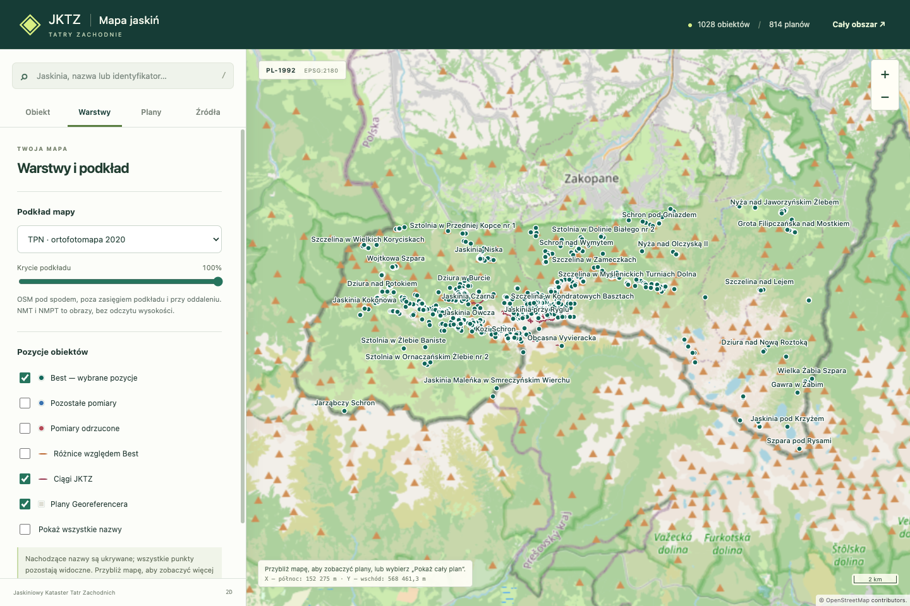
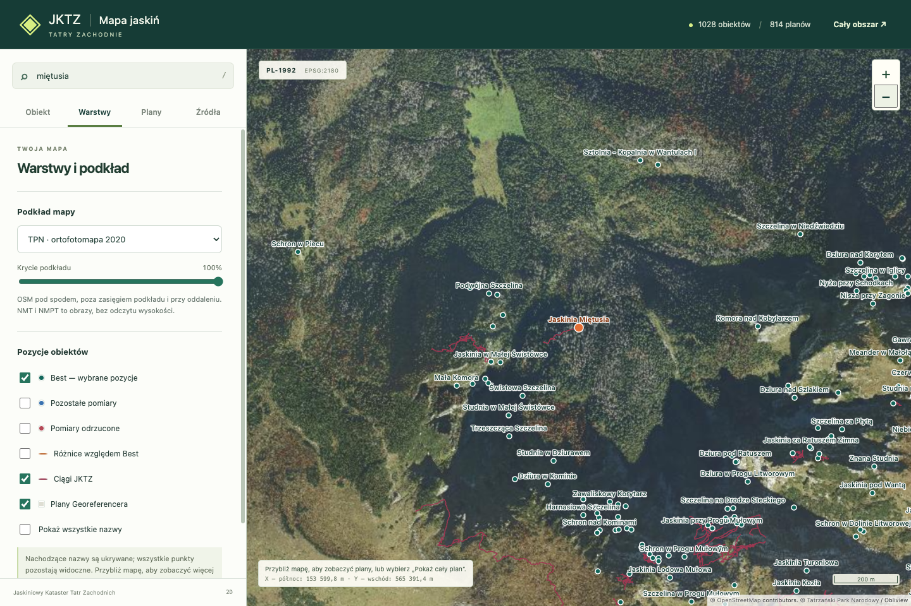
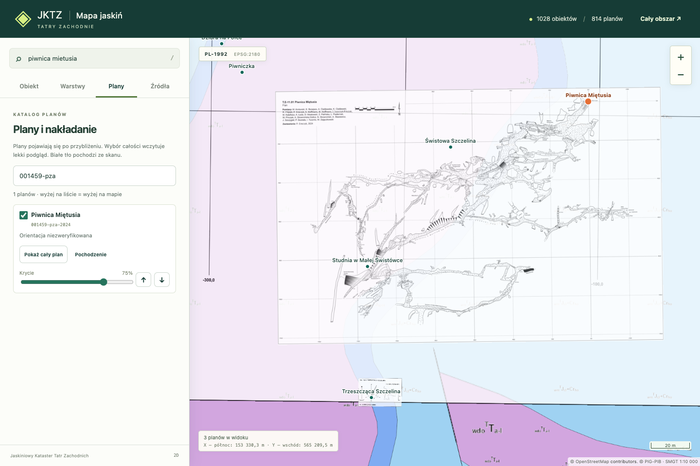

# Mapa jaskiń Tatr Zachodnich

**[Otwórz mapę →](https://dlubom.github.io/jktz-mapa/)**

Statyczna mapa z polskim interfejsem w układzie PL-1992 (EPSG:2180): wyszukiwanie
obiektów, dostępna historia pomiarów, ciągi jaskiniowe i nakładanie planów
na podkłady TPN, geologiczne PIG-PIB lub OpenStreetMap. Zbudowana w TypeScript i OpenLayers.

## Zobacz mapę

**Cały obszar** — rozmieszczenie obiektów w Tatrach Zachodnich na podkładzie OpenStreetMap.

**Okolice Jaskini Miętusiej** — pozycje obiektów i ciągi JKTZ na ortofotomapie TPN z 2020 roku.

**Piwnica Miętusia** — szczegół planu przy kryciu 75% na odkrytej mapie geologicznej Tatr PIG-PIB.

Zrzuty z [publicznej mapy](https://dlubom.github.io/jktz-mapa/).
Autorstwo podkładów jest widoczne na ilustracjach; pochodzenie i autorstwo planów
można sprawdzić w mapie przyciskiem „Pochodzenie”.

## Dane

Mapa łączy pełne katalogi z wydań trzech projektów:

- [Jaskiniowy Kataster Tatr Zachodnich](https://github.com/dlubom/Jaskiniowy-Kataster-Tatr-Zachodnich) — ciągi pomiarowe.
- [GPS Kataster Obiektów Tatr](https://github.com/dlubom/gps-kataster-obiektow-tatr) — obiekty, pomiary i pozycje Best.
- [Georeferencer](https://github.com/dlubom/Georeferencer) — georeferencjonowane plany.

Wersje, pochodzenie i niepewności danych są dostępne w mapie.
Best oznacza pozycję wybraną w katalogu, nie deklarację dokładności.

Podkłady geologiczne to [Szczegółowa Mapa Geologiczna Tatr 1:10 000](https://baza.pgi.gov.pl/cbdg/geoportal/uslugi/gis)
w wariantach zakrytym i odkrytym. Pojawiają się po przybliżeniu; legenda
jest dostępna przy wyborze podkładu. Poza pokryciem usługi widoczny jest OSM.

## Rozwój

Instrukcje uruchomienia, testów i publikacji: [AGENTS.md](AGENTS.md).
Publikacja na GitHub Pages jest uruchamiana ręcznie przez GitHub Actions.

## Odnośniki do opisów jaskiń

„Opis jaskini ↗” otwiera potwierdzony opis w nowej karcie. Wyjątki URL są w
[słowniku mapy](src/data/cave-descriptions.json), pozostałe wersje i referencje PIG
w źródłach. Brak linku nie oznacza nieobecności jaskini w PIG.
